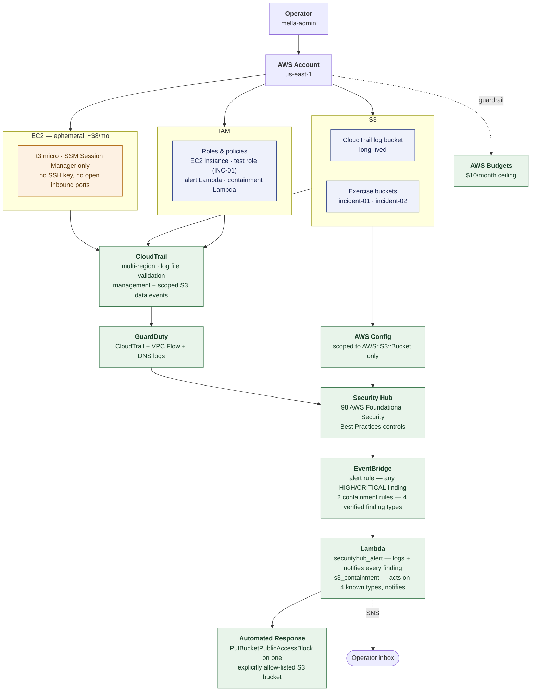
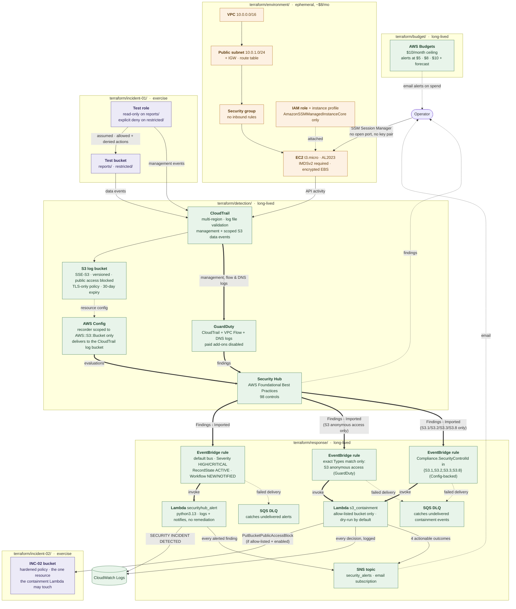
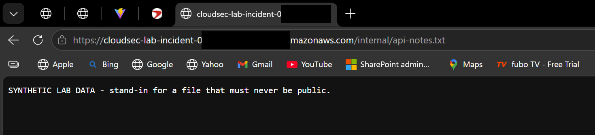
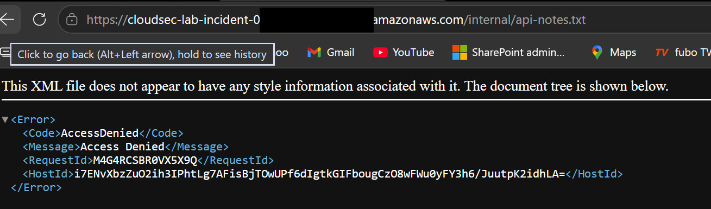
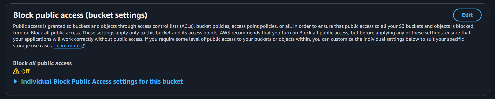
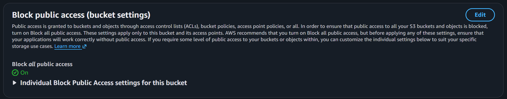
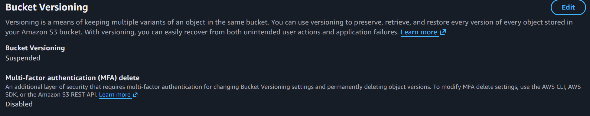
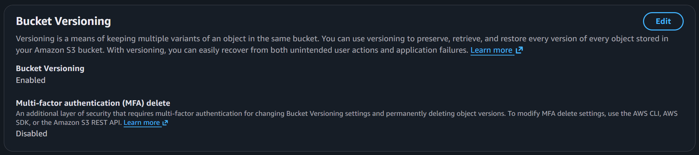

# AWS Cloud Security Detection & Response Lab

A cloud security engineering lab demonstrating
threat detection, security monitoring, incident
investigation and automated remediation within AWS.


Nine phases, three real incident investigations, and a detection gap found,
diagnosed, and closed live against the actual AWS account — not a sandbox
mockup. Every number in this README (timestamps, finding IDs, exposure
windows) is sourced from real CloudTrail, GuardDuty, Security Hub, Config,
and CloudWatch Logs output, captured during the work, not written after the
fact.

## Results

| Metric | Value |
| --- | --- |
| Security incidents investigated & written up | **3** — [INC-01](incidents/incident-01-iam.md), [INC-02](incidents/incident-02-s3.md), [INC-03](incidents/incident-03-detection-and-response.md) |
| Detection workflows | **4** — real-time Security Hub/EventBridge alerting (any HIGH/CRITICAL finding), AWS Config-backed S3 standards controls, a custom 6-control S3 posture check, CloudTrail-based IAM session reconstruction |
| Automated remediation workflows | **1 action, 2 verified trigger families** — GuardDuty's anonymous-access finding, and the Config-backed `S3.1`/`S3.2`/`S3.3`/`S3.8` "block public access" family, both sharing one non-destructive API call, against one allow-listed resource (see [why narrow beats broad](docs/phase-9-automated-containment.md#1-the-scope-decision)) |
| Infrastructure deployed via Terraform | **100%** — 6 independent state directories, zero console-created resources |
| Lambda unit tests | **48 passing**, zero network calls, zero real AWS credentials required |
| EventBridge → Lambda invocation latency | **< 1 second**, consistently |
| AWS Config → Security Hub detection latency | **~2m47s**, genuine bucket exposure → a real `FAILED` finding, measured live, not assumed |
| Monthly cost ceiling | **$10**, hard budget, alerts at $5 / $8 / $10 + forecast |

> **The unglamorous part, included anyway:** turning on AWS Config didn't
> explain itself cleanly. Real findings for this account's S3 controls
> appeared with `CreatedAt` timestamps *predating* the Config recorder by
> twelve days — which meant tracing real CloudTrail events
> (`BatchGetResourceConfig`, `PutEvaluations`) to confirm Security Hub had
> already auto-provisioned its own Config rules into this account and was
> simply waiting for a recorder to evaluate them against, rather than
> assuming the first plausible explanation. A clean "we flipped a switch and
> it worked" story would have been easier to write and less accurate.

**Jump to:** [Results](#results) ·
[Architecture](#architecture) ·
[Technologies](#technologies) ·
[Security Objectives](#security-objectives) ·
[Infrastructure Deployment](#infrastructure-deployment) ·
[Detection Pipeline](#detection-pipeline) ·
[Incident Scenarios](#incident-scenarios) ·
[Automated Response](#automated-response) ·
[Incident Investigation](#incident-investigation) ·
[Screenshots](#screenshots) ·
[Security Considerations](#security-considerations) ·
[Lessons Learned](#lessons-learned)

---

## Architecture

The big picture: one AWS account, three resource pillars feeding one
detection pipeline, ending in one narrowly-scoped automated response.



Reading the shape: everything above `CloudTrail` is *what the account does*
— three independent pillars (compute, storage, identity) that all produce
activity. Everything from `CloudTrail` down is *one linear pipeline* that
turns that activity into a decision: log it and notify (always), or, for two
independently-verified trigger families (four finding types) against
exactly one known resource, also fix it.

The module-by-module version — every Terraform directory, lifecycle
color-coding, exact EventBridge filter criteria — is further down in
[Infrastructure Deployment](#infrastructure-deployment), and as its own file
at [diagrams/architecture.md](diagrams/architecture.md).

---

## Technologies

| Category | Used here |
| --- | --- |
| **Infrastructure as code** | Terraform 1.15, `hashicorp/aws` provider, `hashicorp/archive` (Lambda packaging) — six independent state directories, one per lifecycle |
| **Detection** | CloudTrail (multi-region, management + scoped S3 data events), GuardDuty (CloudTrail + VPC Flow + DNS), Security Hub (AWS Foundational Security Best Practices, 98 controls), AWS Config (scoped to `AWS::S3::Bucket` only) |
| **Response** | EventBridge (three rules — broad alert, two narrow containment rules), Lambda (Python 3.13 — `securityhub_alert`, `incident_containment`), SNS (shared notification topic), SQS (dead-letter queues, both EventBridge-target-level and function-level) |
| **Observability** | CloudWatch Logs (structured JSON + human-readable alert blocks), CloudWatch Log Insights-ready output |
| **Cost control** | AWS Budgets ($10/month ceiling, alerts at $5/$8/$10 + forecast) |
| **Language / runtime** | Python 3.13 + boto3/botocore, PowerShell 5.1 (detection and self-test scripts) |
| **Testing** | `unittest` / `pytest` — 48 tests across both Lambda handlers, no network calls, no real AWS credentials required |
| **Tooling** | AWS CLI v2, Git, VS Code, Claude Code |

---

## Security Objectives

- **Detect real misconfigurations with native AWS services** — no
  third-party SIEM, no agent install, nothing beyond what GuardDuty,
  Security Hub, and CloudTrail provide out of the box.
- **Investigate from raw evidence, not a dashboard summary.** Every incident
  report in this repo is reconstructed from CloudTrail `lookup-events`,
  GuardDuty `get-findings`, and CloudWatch Logs directly — the kind of
  evidence that holds up in a real investigation, not a screenshot of a
  console banner.
- **Automate response only where the blast radius is explicit and bounded.**
  The one Lambda in this repo authorized to write to a real resource acts on
  four independently-verified finding types, against exactly one
  allow-listed resource, with one non-destructive, idempotent API call —
  never "any HIGH finding → remediate." See
  [Automated Response](#automated-response).
- **Keep cost bounded without silently losing coverage.** A hard $10/month
  budget ceiling, and every cost-driven decision (scoping AWS Config to one
  resource type instead of all of them, disabling GuardDuty's paid
  protection plans) documented as an explicit trade-off with a compensating
  control, not a silent gap.
- **Treat a surprising result as something to investigate, not accept.**
  When Security Hub findings appeared with timestamps predating the Config
  recorder that supposedly caused them, that got traced to a real root cause
  via CloudTrail rather than written up as "Config fixed it." See
  [Incident 02's addendum](incidents/incident-02-s3.md#2-detection).

---

## Infrastructure Deployment

Six Terraform state directories, deliberately separated by lifecycle so a
single `apply`/`destroy` can never touch more than one blast radius:

| Directory | Lifecycle |
| --- | --- |
| [terraform/budget/](terraform/budget/) | Long-lived. Cost guardrails — leave running. |
| [terraform/detection/](terraform/detection/) | Long-lived. CloudTrail, GuardDuty, Security Hub — leave running. |
| [terraform/response/](terraform/response/) | Long-lived. EventBridge rules, alert Lambda, containment Lambda, DLQs — leave running. |
| [terraform/environment/](terraform/environment/) | Ephemeral. **Run `terraform destroy` between sessions** — roughly $8/month if left up. |
| [terraform/incident-01/](terraform/incident-01/), [terraform/incident-02/](terraform/incident-02/) | Exercise. One bucket/role per incident, toggled insecure/hardened by a single variable. |

<details>
<summary>Module-by-module architecture diagram</summary>



Green is long-lived and always on. Orange is destroyed between sessions to
avoid EC2 charges. Purple is per-exercise.

</details>

> **Free trials for GuardDuty and Security Hub end approximately 2026-09-08.**
> Review spend in Cost Explorer before then — see [Phase 4 §6](docs/phase-4-detection-services.md#6-cost).

### Prerequisites

| Tool | Purpose |
| --- | --- |
| [AWS CLI v2](https://docs.aws.amazon.com/cli/latest/userguide/getting-started-install.html) | Authenticating to the lab account and querying resources |
| [Terraform](https://developer.hashicorp.com/terraform/install) | Provisioning and tearing down lab infrastructure |
| [Git](https://git-scm.com/downloads) | Version control |
| [VS Code](https://code.visualstudio.com/) | Editing, with the HashiCorp Terraform and AWS Toolkit extensions |
| [Python 3.13](https://www.python.org/downloads/) | Lambda function runtime and helper scripts |

```powershell
winget install --id Amazon.AWSCLI -e
winget install --id Hashicorp.Terraform -e
aws --version; terraform version; git --version; python --version
```

> **Python note:** Lambda code targets **3.13**, matching the `python3.13`
> Lambda runtime. Create the virtualenv with `py -3.13 -m venv .venv` so the
> interpreter is pinned explicitly regardless of what bare `python` resolves
> to.

### Deploying it yourself

Each directory below is its own Terraform state — apply them in this order
the first time; after that, any one can be re-applied independently.

```powershell
# 1. Cost guardrail first - so nothing else can silently overspend
cd terraform/budget;      terraform init; terraform apply

# 2. Always-on detection
cd ../detection;          terraform init; terraform apply

# 3. Alerting + automated containment (dry-run by default - see below)
cd ../response;           terraform init; terraform apply

# 4. Ephemeral exercise environment - destroy when not actively using it
cd ../environment;        terraform init; terraform apply
#   ... work ...
terraform destroy

# 5. Incident exercises - one bucket/role per incident, toggled by a variable
cd ../incident-02;        terraform init; terraform apply -var harden=true
```

`terraform/response/terraform.tfvars.example` documents every override,
including `enable_auto_containment` — **off by default.** A fresh deploy logs
every decision the containment Lambda would have made without ever calling a
mutating API; flip it to `true` only after reviewing a few
`would_contain_but_disabled` log lines. See
[Automated Response](#automated-response).

---

## Detection Pipeline

```
AWS API activity → CloudTrail → GuardDuty ─┐
                                 AWS Config ┴→ Security Hub → EventBridge → Lambda
```

- **CloudTrail** ([Phase 4](docs/phase-4-detection-services.md)) — multi-region,
  log file validation on, management events plus S3 data events scoped to
  this lab's own exercise buckets (so investigations can answer "was this
  object actually read," not just "was the bucket policy changed").
- **GuardDuty** — continuous analysis of CloudTrail, VPC Flow Logs, and DNS
  logs. Paid protection plans (Malware Protection, Runtime Monitoring)
  deliberately disabled — a documented cost decision, not an oversight.
- **AWS Config** — recorder scoped to `AWS::S3::Bucket` only, not "all
  supported resource types," keeping the known cost risk bounded. Added
  specifically to close a documented gap: Security Hub's S3 standards
  controls are evaluated by Config rules, and without a recorder they report
  `ENABLED` while detecting nothing — see
  [Incident 02 §2](incidents/incident-02-s3.md#2-detection) for the real
  before/after finding that proves it now works.
- **Security Hub** — the AWS Foundational Security Best Practices standard,
  98 controls, now genuinely evaluating the S3 subset of them instead of
  reporting `ENABLED` with nothing behind it. Custom PowerShell checks in
  [`detections/`](detections/) remain the compensating control for the
  resource types Config isn't scoped to cover.
- **EventBridge → Lambda** ([Phase 7](docs/phase-7-eventbridge-alerting.md),
  [Phase 8](docs/phase-8-incident-handler.md)) — every Security Hub finding
  at `HIGH`/`CRITICAL` severity reaches a Lambda within seconds and is logged
  with all nine fields an analyst needs to triage (`SECURITY INCIDENT
  DETECTED`: Finding ID, Finding, Type, Description, Resource, Severity,
  Account, Region, Timestamp) — no console trip required, and now also
  reaches an inbox via SNS.

**Real, measured latency**, not a synthetic test: exposing the Incident 02
bucket for real and watching AWS Config's evaluation catch up produced a
genuine `FAILED` finding in **~2m47s**. EventBridge itself is the fast part
of this chain — the detection services are where real-world latency
actually lives, and this repo measured that instead of assuming it.

---

## Incident Scenarios

| ID | Report | Summary |
| --- | --- | --- |
| INC-01 | [IAM Role Misuse Investigation](incidents/incident-01-iam.md) | 11 actions from one assumed role; 7 denied including a privilege-escalation attempt. Exposed that 7 of 11 were invisible without CloudTrail data events. |
| INC-02 | [Insecure S3 Configuration](incidents/incident-02-s3.md) | Bucket made publicly readable, detected, investigated, and remediated in a 2m23s exposure window. Exposed that Security Hub's S3 controls detected nothing without AWS Config — later closed by enabling Config and re-verifying the same bucket produces real findings and real automated containment. |
| INC-03 | [Detection and Response Pipeline, Both Branches](incidents/incident-03-detection-and-response.md) | One real S3 exposure (contained automatically in ~3m19s) run alongside three real GuardDuty sample findings with no automated remedy, in the same exercise. Proved the severity/type-based branch itself: the remediable finding was contained, one unremediable HIGH finding was notified, two unremediable MEDIUM findings were correctly filtered out, and the containment Lambda was confirmed never invoked for any of the three. |

### INC-02 evidence — before and after remediation

Anonymous request carrying no AWS credentials, against the same object:

| Before — `HTTP 200`, world-readable | After — `HTTP 403 AccessDenied` |
| --- | --- |
|  |  |

Bucket configuration, same console panels:

| Before | After |
| --- | --- |
|  |  |
|  |  |

Remediation was a single Terraform variable — `terraform apply -var=harden=true`,
`Plan: 2 to add, 5 to change` — rather than a sequence of console clicks.

---

## Automated Response

One Lambda (`cloudsec-lab-s3-containment`) is authorized to write to a real
resource — deliberately scoped to the narrowest version of the job
([Phase 9](docs/phase-9-automated-containment.md)):

```
known finding type  +  known lab resource  +  approved remediation  →  Lambda
```

not "any HIGH finding → remediate." Concretely: four verified trigger
conditions across two ASFF fields — GuardDuty's S3-anonymous-access-granted
finding (`Types`), and the Config-backed `S3.1`/`S3.2`/`S3.3`/`S3.8`
"block public access" family (`Compliance.SecurityControlId`) — one explicit
bucket-ARN allowlist, and one idempotent, non-destructive call
(`s3:PutBucketPublicAccessBlock`, all four settings `true`) — never a policy
rewrite, never a delete. Two independent gates (`enable_auto_containment`
**and** the allowlist) must both agree before anything is touched, and every
decision — including every time it decides *not* to act — is logged and,
since the containment family was widened, published to SNS as well.

**This isn't a design claim taken on faith.** `S3.2` was verified against a
real live finding — the bucket was genuinely re-exposed, AWS Config
genuinely evaluated it, and the Lambda genuinely restored Block Public
Access, independently re-confirmed via the live S3 API (`get-public-access-block`,
an anonymous `curl` returning `403`) rather than trusted from a log line.
`S3.1`/`S3.3`/`S3.8` were verified the same way the lab's own self-test
scripts already prove other paths: a synthetic `BatchImportFindings` finding
against a policy-hardened bucket (so no real public exposure was ever
possible), confirming the same real `PutBucketPublicAccessBlock` call for
each. Full story: [Phase 9 §11](docs/phase-9-automated-containment.md#11-extension--a-second-trigger-family-and-notification).

---

## Incident Investigation

Every incident in this repo is reconstructed from primary evidence, not
summarized from a console banner:

- **CloudTrail `lookup-events`**, reconstructed into a chronological timeline
  — INC-01 includes a full management-event table with principal, action,
  and significance columns.
- **Custom detection scripts** —
  [`incidents/incident-01/investigate.ps1`](incidents/incident-01/investigate.ps1)
  (IAM session reconstruction from CloudTrail), and in
  [`detections/`](detections/): `s3-posture-check.ps1` (six-control S3
  posture check built as a compensating control before AWS Config was
  enabled) and the self-test scripts that exercise the live
  alerting/containment pipeline end to end.
- **Direct verification against the real API**, not just a log line — every
  remediation in this repo is confirmed by re-querying the actual resource
  state (`get-public-access-block`, an anonymous `curl` request) rather than
  trusting that a "contained" log message means the API call actually
  succeeded.
- **A tooling defect, found and documented, not hidden.** INC-02's own
  investigation tooling silently dropped four CloudTrail events over a
  PowerShell JSON-parsing edge case — logged as a remediation item, because
  an investigation tool that loses evidence is worse than no tool.
- **A surprising result, traced to root cause rather than accepted at face
  value.** Real Security Hub findings appeared with timestamps predating the
  Config recorder that supposedly produced them — traced via CloudTrail
  (`BatchGetResourceConfig`, `PutEvaluations`) to Security Hub having
  auto-provisioned its own dormant Config rules into the account well before
  today, waiting only for a recorder to evaluate against.

| Incident | Investigative technique it showcases |
| --- | --- |
| [INC-01](incidents/incident-01-iam.md) | CloudTrail session reconstruction; why data events (not just management events) are necessary to see 7 of 11 actions |
| [INC-02](incidents/incident-02-s3.md) | Catching a compliance dashboard reporting "enabled" controls that detect nothing, via an independent custom check — then closing the gap for real and re-verifying with a live finding |
| [INC-03](incidents/incident-03-detection-and-response.md) | Proving a negative directly (searching the containment Lambda's own logs for zero matches) rather than assuming a rule's scope holds; catching that two of three "attack-shaped" findings correctly never alerted, on real GuardDuty severity scores rather than a chosen-to-pass synthetic value |

---

## Screenshots

Every category below is backed by **real evidence already captured from this
account** during the work — shown here as the actual CLI/log output rather
than invented. The PNG console captures themselves are the one piece of this
README still pending manual capture (this assistant has API/CLI access to
the account but no browser), tracked with the exact console path needed for
each in [screenshots/README.md](screenshots/README.md)'s shot list.

<details>
<summary><b>1. GuardDuty finding</b> — <code>Policy:S3/BucketAnonymousAccessGranted</code></summary>

```json
{
  "Id": "66cff41a3cd156e2591849cf30f0cfb1",
  "Type": "Policy:S3/BucketAnonymousAccessGranted",
  "Severity": 8.0,
  "Title": "Amazon S3 Public Anonymous Access was granted for the S3 bucket cloudsec-lab-incident-02-...",
  "Service": { "Count": 2, "Archived": false },
  "Resource": { "ResourceType": "AccessKey" }
}
```

Capture: GuardDuty console → Findings → this finding, expanded detail panel.
Save as `screenshots/11-guardduty-finding.png`.

</details>

<details>
<summary><b>2. Security Hub finding</b> — same finding, imported</summary>

```json
{
  "Id": "arn:aws:guardduty:us-east-1:...:detector/.../finding/66cff41a3cd156e2591849cf30f0cfb1",
  "RecordState": "ACTIVE",
  "Workflow": { "Status": "NEW" },
  "Severity": { "Label": "HIGH" }
}
```

Capture: Security Hub console → Findings → filter by this finding ID.
Save as `screenshots/11-securityhub-finding.png`.

</details>

<details>
<summary><b>3. CloudTrail event</b> — the <code>PutBucketPolicy</code> that caused it</summary>

```
EventName:  PutBucketPolicy
EventTime:  2026-10-02T20:53:53Z
EventId:    db633095-ee0f-4f6a-b03f-f78abddd6363
UserName:   mella-admin
```

Capture: CloudTrail console → Event history → this event, expanded.
Save as `screenshots/11-cloudtrail-putbucketpolicy.png`.

</details>

<details>
<summary><b>4. EventBridge rule</b> — the narrow containment rule</summary>

```json
{
  "Name": "cloudsec-lab-s3-anonymous-access-containment",
  "State": "ENABLED",
  "EventPattern": "{\"detail\":{\"findings\":{\"RecordState\":[\"ACTIVE\"],\"Types\":[\"TTPs/Policy:S3-BucketAnonymousAccessGranted\"]}},\"detail-type\":[\"Security Hub Findings - Imported\"],\"source\":[\"aws.securityhub\"]}"
}
```

Capture: EventBridge console → Rules → this rule → Event pattern tab.
Save as `screenshots/11-eventbridge-rule.png`.

</details>

<details>
<summary><b>5. Lambda execution</b> — the containment Lambda, reacting to a real Config-backed finding</summary>

```
[WARNING] 2026-10-18T20:34:24.669Z  936505be-45e1-437d-adf6-36aef8e474e6
{"containment_action": "contained",
 "finding_id": "arn:aws:securityhub:us-east-1:0891****7191:security-control/S3.2/finding/244dec58-...",
 "finding_types": ["Effects/Data Exposure"],
 "bucket_arn": "arn:aws:s3:::cloudsec-lab-incident-02-0891****7191",
 "auto_contain_enabled": true,
 "detail": "PutPublicAccessBlock: all four settings enabled."}
```

Capture: CloudWatch Logs → `/aws/lambda/cloudsec-lab-s3-containment` → this
log stream, `[WARNING]` row expanded. Save as
`screenshots/11-lambda-execution-contained.png`.

</details>

<details>
<summary><b>6. Terraform apply</b> — deploying the standards-based containment extension</summary>

```
Plan: 4 to add, 3 to change, 0 to destroy.
  + aws_cloudwatch_event_rule.s3_standards_containment[0]
  + aws_cloudwatch_event_target.containment_lambda_standards[0]
  + aws_iam_role_policy.alert_notify
  + aws_lambda_permission.allow_eventbridge_containment_standards[0]
  ~ aws_lambda_function.alert will be updated in-place
  ~ aws_lambda_function.containment will be updated in-place
  ~ aws_sqs_queue_policy.containment_dlq will be updated in-place
Apply complete! Resources: 4 added, 3 changed, 0 destroyed.
```

Capture: terminal running this `terraform apply`. Save as
`screenshots/11-terraform-apply.png`.

</details>

<details>
<summary><b>7. Automated remediation</b> — verified against the real S3 API, not the log line</summary>

```
=== Public Access Block ===
{
    "PublicAccessBlockConfiguration": {
        "BlockPublicAcls": true, "IgnorePublicAcls": true,
        "BlockPublicPolicy": true, "RestrictPublicBuckets": true
    }
}
=== Anonymous read attempt ===
HTTP 403
=== SNS delivery, same window ===
NumberOfNotificationsDelivered: 3   NumberOfNotificationsFailed: 0
```

Capture: terminal running these three checks back to back. Save as
`screenshots/11-automated-remediation.png`.

</details>

---

## Security Considerations

**Nothing sensitive is committed — verified, not assumed.** `.gitignore`
excludes:

```
*.tfstate, *.tfstate.*      # Terraform state - resource IDs, sometimes secrets
*.tfvars, *.tfvars.json     # including terraform.tfvars - account-specific overrides
.env, .env.*                # environment files
credentials, aws_credentials, .aws/
*.pem, *.key, *.p12         # key material
incidents/**/evidence/      # raw CloudTrail JSON - carries real source IPs, session tokens
```

A full `git log --all --diff-filter=A` sweep of this repo's history for
these patterns returns nothing — no secret has ever been committed, not just
currently ignored.

**Least privilege, enforced structurally.** The containment Lambda's IAM
role is the only identity in the lab with standing write access to a real
resource, and that grant is a single `s3:GetBucketPublicAccessBlock`/
`s3:PutBucketPublicAccessBlock` statement scoped to one explicit bucket ARN
— never a wildcard, never a prefix match — plus one `sns:Publish` statement
scoped to one topic ARN. Widening the containment family from one trigger to
four (Phase 9 §11) only ever meant adding match conditions, never loosening
this grant.

**Separate Terraform state per lifecycle** bounds the blast radius of any
single `apply`/`destroy` to one concern — budget, detection, response,
ephemeral environment, or one incident exercise — never all of them at once.

**Redaction practice for published evidence**, documented in
[screenshots/README.md §3](screenshots/README.md#3-redaction--do-this-before-committing):
account ID, source IP, and session tokens are boxed out of every console
screenshot before it's committed, since blurring is sometimes reversible and
solid boxes aren't.

**Known, documented limitations** rather than silent gaps: AWS Config is
scoped to `AWS::S3::Bucket` only, not every resource type (a cost decision —
other resource types' Security Hub controls still report "enabled" while
detecting nothing, compensated for by custom detection scripts where it
matters); GuardDuty's paid protection plans are off; this is a
single-account lab at lab scale, not a multi-account landing zone.

---

## Lessons Learned

The most transferable lessons across all three incidents and the Phase 9
containment extension, each proven against the real account, not asserted:

1. **An enabled control is not a working control — and the fix has to be
   verified the same way the gap was.** Security Hub reported five S3
   controls as `ENABLED` and caught nothing, because AWS Config — the
   engine those controls depend on — was never running. Enabling Config
   later didn't get taken on faith either: the same bucket was re-exposed
   for real, and the same API queried, to confirm a genuine `FAILED`
   finding now exists where there was silence before.
   ([INC-02](incidents/incident-02-s3.md))
2. **A surprising result is worth tracing to its actual cause.** Real
   findings appeared with timestamps predating the Config recorder that
   supposedly produced them. The easy write-up — "enabling Config fixed
   it" — would have been wrong; the real cause, found via CloudTrail, was
   that Security Hub had already auto-provisioned its own dormant Config
   rules into the account, waiting only for a recorder to evaluate against.
   ([INC-02 §2](incidents/incident-02-s3.md#2-detection))
3. **Synthetic verification can be as rigorous as a live exercise, without
   the risk.** Proving three more finding types reach the containment
   Lambda correctly didn't require three more real misconfigurations — one
   (`S3.3`, "block public write") structurally *couldn't* be tested live
   without violating this lab's own safety rule against ever granting real
   public write access. A synthetic `BatchImportFindings` finding against a
   policy-hardened bucket proved the same code path, the same real
   `PutBucketPublicAccessBlock` call, with zero exposure window.
   ([Phase 9 §11](docs/phase-9-automated-containment.md#11-extension--a-second-trigger-family-and-notification))
4. **An IAM action name and an SDK method name are not always the same
   string.** `s3:GetPublicAccessBlock` (the boto3 client method) vs.
   `s3:GetBucketPublicAccessBlock` (the real IAM action) is a silent
   mismatch with no error at plan time — only at the moment a real request
   is evaluated. ([Phase 9 §4](docs/phase-9-automated-containment.md#4-iam-the-only-write-permission-in-the-lab))
5. **Remediation expressed as a Terraform diff beats a sequence of console
   clicks** — reviewable, repeatable, and auditable after the fact.
   ([INC-02](incidents/incident-02-s3.md))
6. **Cost decisions are security decisions**, and the trade-off has to be
   explicit, with a compensating control, not just cheaper and silently
   worse. ([Phase 4](docs/phase-4-detection-services.md),
   [INC-02](incidents/incident-02-s3.md))
7. **Narrow automated response beats broad automated response — but narrow
   doesn't have to mean frozen.** "Known finding type + known resource +
   approved action" grew from one trigger to four without ever widening the
   action itself: `S3.1`/`S3.2`/`S3.3`/`S3.8` all check facets of the exact
   setting the one existing `PutPublicAccessBlock` call already fixes, so
   the trigger could widen safely while the blast radius stayed identical.
   ([Phase 9 §1](docs/phase-9-automated-containment.md#1-the-scope-decision))
8. **"Does it alert correctly" and "does it correctly stay silent" are two
   separate claims, and both need real evidence.** Running a remediable and
   an unremediable finding in the same exercise showed a HIGH finding
   notify, a MEDIUM one correctly not notify, and the containment Lambda
   stay uninvoked for all three non-S3 findings — confirmed by searching
   its own logs for zero matches, not by trusting the rule's intended
   scope. ([INC-03](incidents/incident-03-detection-and-response.md))

---

## Layout

| Directory | Contents |
| --- | --- |
| `terraform/` | Infrastructure as code for the lab environment |
| `lambda/` | Lambda function source for automated response actions |
| `detections/` | Detection rules, queries, and live self-test scripts |
| `incidents/` | Incident write-ups and investigation notes |
| `diagrams/` | [Architecture and data-flow diagrams](diagrams/architecture.md) |
| `screenshots/` | Console evidence captured during exercises |
| `docs/` | Phase-by-phase build documentation |

## Documentation

| Phase | Document | Status |
| --- | --- | --- |
| 1 | [Environment Setup](docs/phase-1-environment-setup.md) | Complete |
| 2 | [Cost Guardrails](docs/phase-2-cost-guardrails.md) | Complete |
| 3 | [Base AWS Environment](docs/phase-3-base-environment.md) | Complete |
| 4 | [Detection Services](docs/phase-4-detection-services.md) | Complete |
| 5 | [Incident #1 — IAM Investigation](docs/phase-5-incident-01.md) | Complete |
| 6 | [Incident #2 — Insecure S3 Configuration](docs/phase-6-incident-02.md) | Complete |
| 7 | [Near-Real-Time Alerting via EventBridge](docs/phase-7-eventbridge-alerting.md) | Complete |
| 8 | [The Incident Handler](docs/phase-8-incident-handler.md) | Complete |
| 9 | [Automated Containment](docs/phase-9-automated-containment.md) | Complete — extended to a 4-control family + SNS in §11 |
