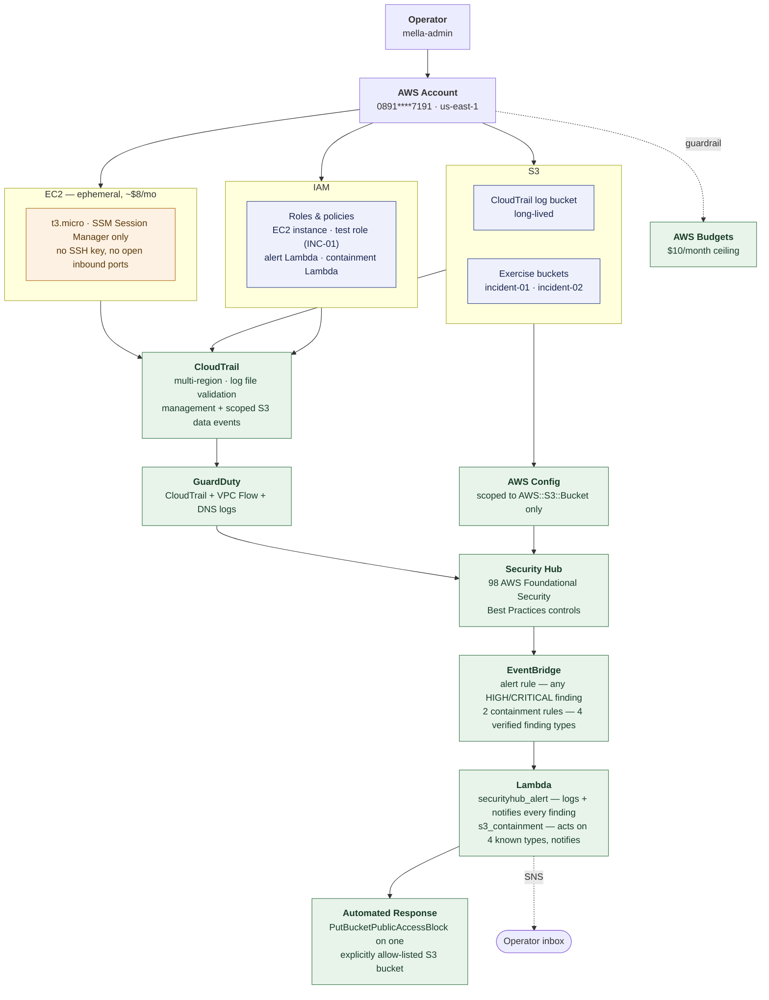

# Architecture

The big picture: one AWS account, three resource pillars feeding one
detection pipeline, ending in one narrowly-scoped automated response.

For the detailed, module-by-module diagram (every Terraform directory,
lifecycle color-coding, exact EventBridge filter criteria) see
[README.md § Architecture](../README.md#architecture) instead — this one is
deliberately the simplified, whole-lab view.

**Reading the shape:** everything above `CloudTrail` is *what the account
does* — three independent pillars (compute, storage, identity) that all
produce activity. Everything from `CloudTrail` down is *one linear
pipeline* that turns that activity into a decision: log it and, for any
actionable outcome, notify a human via SNS (always), or, for two
independently-verified trigger families against exactly one known resource,
also fix it. That narrowing — three sources, one pipeline, one
narrow action at the end, widened only after each new trigger is verified
against a real finding — is deliberate; see
[docs/phase-9-automated-containment.md §1](../docs/phase-9-automated-containment.md#1-the-scope-decision)
and [§11](../docs/phase-9-automated-containment.md#11-extension--a-second-trigger-family-and-notification)
for how "fix it" grew from one case to four without widening the action
itself.

**What actually went live:** both trigger families have been proven against
the real account, not just unit-tested — GuardDuty's anonymous-access
finding, and the AWS Config-backed `S3.1`/`S3.2`/`S3.3`/`S3.8` "block public
access" family, each confirmed with a real or synthetic finding, a real
`PutBucketPublicAccessBlock` call, and the bucket's resulting state
independently re-checked via the live S3 API — see
[docs/phase-9-automated-containment.md §11](../docs/phase-9-automated-containment.md#11-extension--a-second-trigger-family-and-notification).
